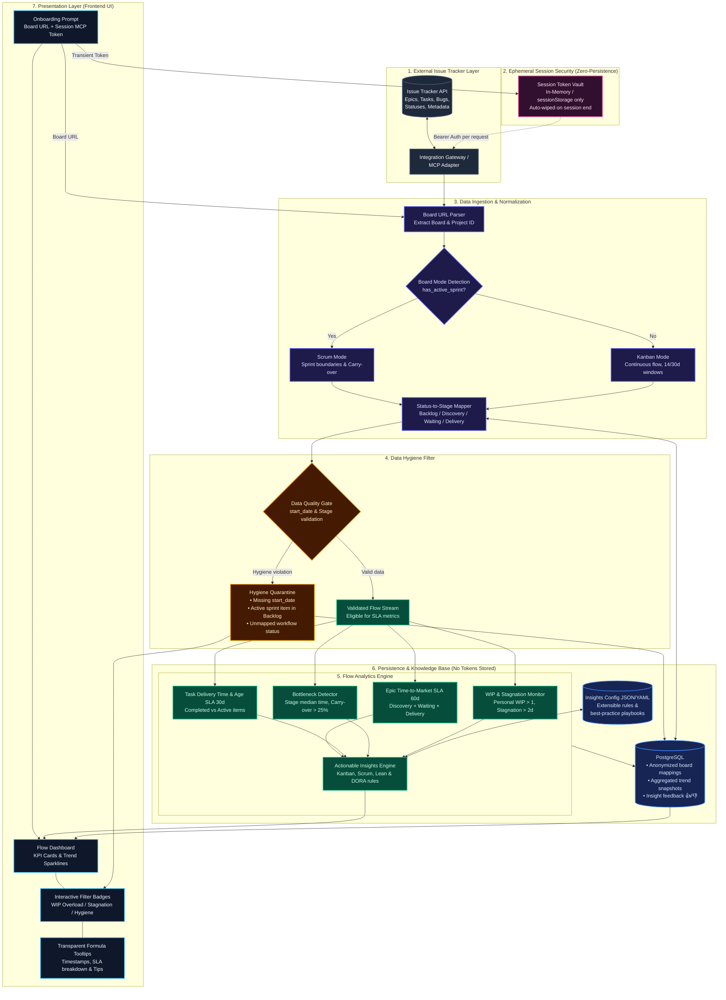

# 🚀 DM-assistant — Flow & Delivery Analytics Engine

**DM-assistant** is an intelligent flow analytics and delivery management tool designed for Delivery Managers, Scrum Masters, and Team Leads. Simply paste a link to your agile board and provide your session MCP token to get instant visibility into delivery speed, bottlenecks, team workload, and board hygiene—backed by actionable recommendations from **Kanban, Scrum, Lean, and DORA** practices.

---

## ✨ Key Features

* **Dual-Mode Board Detection (Scrum & Kanban):** Automatically detects active sprints (`Scrum Mode` with carry-over tracking) or switches to continuous flow (`Kanban Mode` with 14/30-day rolling windows).
* **Epic Time-to-Market (TTM) Breakdown:** Tracks end-to-end delivery across `Discovery`, `Waiting Delivery`, and `Delivery` stages against a configurable **60-day SLA**.
* **Task & Bug Delivery Time / Age:** Measures active delivery speed against a **30-day SLA**, strictly separating completed items (included in averages) from active items (tracked as `Delivery Age`).
* **Data Hygiene Quarantine:** Isolates cards with missing start dates (`start_date = null`), unmapped workflow stages, or active-sprint items left in `Backlog` so they never distort team SLA metrics.
* **WIP & Stagnation Alerts:** Highlights personal overload (`1 person = 1 active task` rule) and items stagnating in a single status for more than **2 days**.
* **Actionable Insights Engine:** Provides context-aware coaching playbooks when bottlenecks, high carry-over (`> 25%`), or WIP overloads are detected.
* **Zero-Persistence Token Security:** Your MCP server token lives strictly in memory during your active browser session and is never written to any database.

---

## 🏗 System Architecture

---

## 📊 Metrics & Methodology

| Metric | Target Entity | Start Trigger | End Trigger | Default SLA |
| :--- | :--- | :--- | :--- | :--- |
| **Time to Market (TTM)** | Epics | First transition into `Discovery` (or `Delivery` if skipped) | Final transition to `Done` | **≤ 60 days** |
| **Delivery Time** | Tasks & Bugs | `start_date` (or first entry into active sprint / `Delivery`) | Final transition to `Done` | **≤ 30 days** |
| **Delivery Age** | Open Tasks / Bugs | `start_date` | Current timestamp (excluded from SLA averages) | Warning at **> 24 days** |
| **Personal WIP** | Team Members | Active items in `Delivery` stage per assignee | Transition out of `Delivery` | **1 item / person** |
| **Status Stagnation** | Active Items | Last status change timestamp | Next status transition | **≤ 2 days** |

---

## 🔒 Security & Privacy

* **Zero-Persistence Authentication:** User MCP tokens are stored exclusively in ephemeral session memory (`In-Memory / sessionStorage`) and passed per request via Bearer authorization. Tokens are never logged or persisted in PostgreSQL.
* **Anonymized Storage:** The database stores only structural status-to-stage mappings, aggregated historical trend snapshots, and anonymous usefulness ratings (`👍 / 👎`) for coaching insights.

---

## UI Preview & Demo

To protect corporate data and internal workflows, UI screenshots are available upon request during the interview process.

The interface includes:

* Real-time flow metrics dashboard (TTM, Lead Time, WIP).
* Automated bottleneck and stagnation alerts.
* Personal overload tracking (1 person = 1 active task rule).
